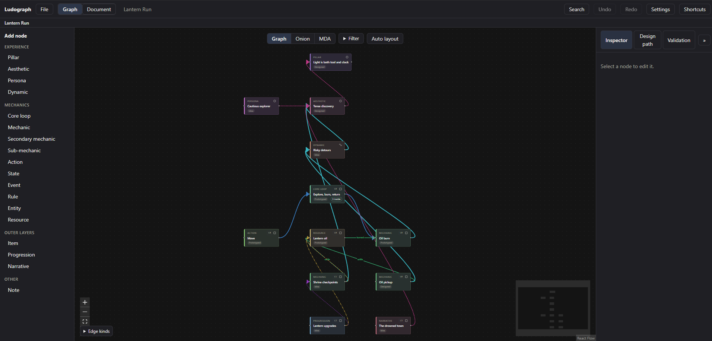
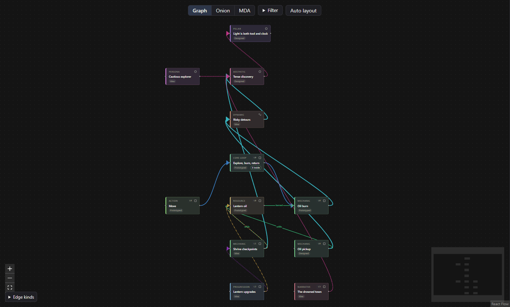

# Ludograph

A web-based diagram editor for game design. You draw mechanics, dynamics, aesthetics, resources,
states and loops as typed nodes and edges, and the tool checks the graph and suggests what to work on
next.

It runs in the browser, there is no backend. Work is autosaved in local storage and can be saved to and
opened from `.ludograph.json` files.



## Background

Two ideas shape the data model:

- MDA (Hunicke, LeBlanc, Zubek): mechanics, dynamics, aesthetics. You write the mechanics, players
  experience the aesthetics. Ludograph tries to make the chain from one to the other easy to draw and
  to check.
- The Onion Model by Paolo Tajè: https://paolos.blog/the-onion-model/

Not from either source, added by Ludograph: the rule that an inner layer should still work without the
outer ones (shown as a warning, can be switched off in settings), the Design Path panel, core-only
prototype mode, and the validation rules.

## What it does

- Typed nodes (pillar, aesthetic, persona, dynamic, mechanic, state, rule, resource and more, plus your
  own kinds) and typed edges (feeds, requires, unlocks, triggers, modifies, conflicts, leads to,
  serves) with rules about what may connect to what.
- Three views of the same data: Graph (free layout), Onion (four rings, drag a node into a ring to
  change its layer) and MDA (three lanes, selecting an aesthetic lights up the mechanics that lead to
  it).
- Drill-down: double-click a node to open the graph inside it.
- Design Path panel, outside-in or core-first, with core-only prototype mode.
- Validation panel with 16 checks.
- A Document view for the written game design document (one-pager, optional sections, your own
  sections, three templates), based on [OpenGDD](https://github.com/berkecuhadar/opengdd). It can pull
  text from the graph, and the Markdown export puts it in front of the graph as the design model.
- Export to Markdown (a GDD), Unity JSON, PNG and SVG.
- Import from Unity code in the File menu: pick a folder, choose what to add, undo if needed.
- A command line tool that adds and checks nodes and edges in a project file, and can scan a Unity
  project's C# code into nodes. See [docs/cli.md](docs/cli.md).



More detail is in [docs/data-model.md](docs/data-model.md).

## Running it

```sh
npm install
npm run dev
```

Also: `npm run lint`, `npm run typecheck`, `npm test`, `npm run build`, `npm run build:cli`.

Press `?` (or the key left of 1) in the app for the keyboard shortcuts.

## Working with a Unity project

Ludograph can fill the graph from your C# code, in the editor or on the command line. Both read
MonoBehaviours, ScriptableObjects and state enums, make a node for each, and add `requires` edges
from `[RequireComponent]`. Running a scan again updates the nodes and never overwrites text you wrote.

- In the editor: File > Import from Unity code, pick the `Assets` folder, tick what to add. The files
  are read in the browser and not uploaded. Undo takes the import back.
- On the command line:

  ```sh
  npm run build:cli
  npm link
  ludograph init design/game.ludograph.json --name "My game"
  ludograph scan-unity design/game.ludograph.json Assets --dry-run
  ludograph validate design/game.ludograph.json
  ```

- With Claude Code: copy [examples/claude/SKILL.md](examples/claude/SKILL.md) into your Unity
  project as `.claude/skills/ludograph/SKILL.md`. Claude then reads the code, proposes layers and
  edges, writes them through the command line tool (which refuses invalid ones) and runs the
  validation. It uses the Claude Code you already have, with your own account. Ludograph itself makes
  no AI calls and needs no key.

All commands, the batch format and the scan rules are in [docs/cli.md](docs/cli.md).

## Plan

Maybe resource-flow simulation, in the spirit of Machinations. Turkish text for the interface.

## License

MIT
